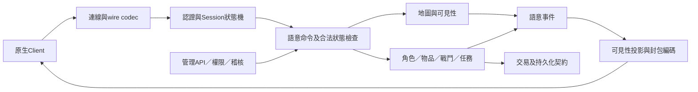
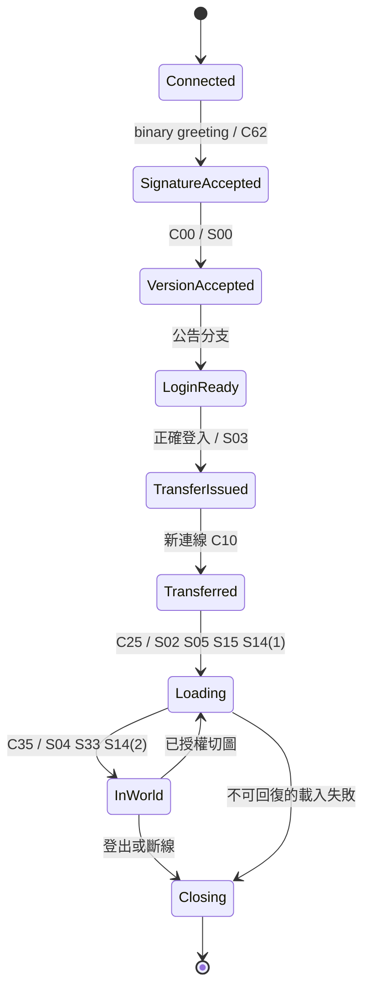

# Server系統規劃

## 共用行為邊界

各實作可選單一程序或多程序；對外可觀察行為必須一致。先做模組化單體，將登入與world視為邏輯邊界；只有量測或部署需求足夠時才拆成微服務。不要為了目錄漂亮先增加訊息系統、分散式交易或跨服複雜度。

## 系統責任與命令流程

1. Transport只做framing、界限、連線生命週期、背壓與限速。不得直接更改角色資產。
2. Protocol依Client profile與方向解碼；同opcode在不同方向是不同封包。未知或非法狀態依明示政策拒絕，不以預設0猜欄位。
3. Application把wire轉成登入、移動、使用物品等命令；控制認證／權限／冪等及交易邊界。
4. Domain裁定遊戲規則及狀態；Client回報是意圖，位置、物品、金額、傷害及技能是否成功由Server裁定。
5. World為每個地圖實例維持有序狀態變更及物件ID；可見性決定誰收到何種投影。自身移動確認與他人移動廣播是不同語意。
6. Persistence以交易提交已承諾狀態；經濟操作不得先回成功再嘗試保存。移動可採不同持久化策略，但必須定義已承諾位置及崩潰回復界線。
7. Admin走與Client相同的合法命令入口或明示管理命令；只有有權限的人能用。管理傳送不得直接繞過載圖狀態機。

## 會話與地圖狀態

這是最低共同狀態；公告請求與創角另見分析缺口。需要補上每個狀態的允許封包、逾時、錯誤回應和是否能重試。載入中不得執行普通地圖命令；成功、取消、失敗與斷線必須有不同出口。

## 權威資料與一致性

- AccountCredential、Character、Session、TransferGrant分開建模；原型「一名字一角色」是目前相容映射，不先認定Client支援現代多角色登入UI。
- WorldInstance、EntityId、Position、Facing、Appearance、Stats由世界／角色責任域管理，地圖座標和畫面鏡頭參數分開。
- ItemDefinition與ItemInstance分開，衣櫃測試slot不得變成正式物品ID；裝備狀態引用物品實例。
- Wallet／Inventory／RewardClaim要明確的交易及重送語意；跨玩家交易按穩定順序鎖定或等價單一所有者命令，避免死鎖與雙花。
- Content資料與角色變動資料分開版本；靜態碰撞與技能規則有來源／版本。原始遊戲資產不放此repo。

## 併發與效能設計

每個Session輸入順序與每張地圖狀態變更順序可追溯；輸出佇列必須有上限、慢客戶端處理及取消。密碼雜湊、重IO和大量DB提交不得阻塞world事件迴圈。採哪種actor、tick或worker模型由實作決定；tick頻率與容量依A-018量測，暫不指定原服頻率。

## 規格、實作與相容層

Codec處理wire細節，Adapter處理語系／版本差異，Domain不含opcode常數。已確認原生行為、推導與自訂補完規則分開。資料庫、ORM、語言及實作架構可不同，但各Server對共同CT必須產生相容結果。
